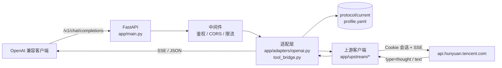

# 混元 AI Studio OpenAI 兼容代理

**Hunyuan AI Studio → OpenAI-Compatible Proxy**　·　把腾讯混元（AI Studio）网页端
在**你自己账号**下已具备的对话能力，封装成本机可用的 OpenAI 兼容接口。


> [!WARNING]
> **⚠️ 免责声明（务必先读）**
>
> * **仅供个人学习 / 技术研究 / 协议分析，严禁任何商业用途。** 商业使用需事先取得
>   书面授权，详见 [`LICENSE`](LICENSE)。
> * **本项目与腾讯公司无关**，未获其授权、认可或背书；不是官方 API 的替代品。
> * 只复用**你本人手动登录**后产生的会话，**不做**自动登录、验证码识别、凭证收集，
>   **不绕过**付费 / 配额 / 风控 / 任何访问控制。
> * 上游接口来自逆向分析，**随时可能变更**；本项目宁可明确失败（`501/502/504`），
>   也不伪造"成功"的回答。
> * 使用风险（账号风控、额度消耗、数据丢失）**由你自行承担**。
>
> 完整条款：[`DISCLAIMER.md`](DISCLAIMER.md)　·　安全报告：[`SECURITY.md`](SECURITY.md)

---

## 目录

- [它是什么](#它是什么)
- [特性](#特性)
- [架构](#架构)
- [快速开始](#快速开始)
- [客户端配置](#客户端配置)
- [配置说明](#配置说明)
- [协议支持矩阵](#协议支持矩阵)
- [工具链](#工具链)
- [常见问题](#常见问题)
- [目录结构](#目录结构)
- [测试与自检](#测试与自检)
- [隐私与合规](#隐私与合规)
- [参与贡献](#参与贡献)
- [许可证](#许可证)

## 它是什么

```text
OpenAI SDK / Cherry Studio / AstrBot / 任意 OpenAI 兼容客户端
        │  POST /v1/chat/completions  (JSON, stream / non-stream)
        ▼
本地 FastAPI（本项目，默认 127.0.0.1:1010）
        │  协议适配层：profile 驱动 + 本地渲染（system / 历史 / tools）
        ▼
https://api.hunyuan.tencent.com/api/**   ← 抓包确认的真实上游（跨域，Origin=aistudio.tencent.com）
        │  SSE: speech_type(thought) → thought* → speech_type(text) → text* → meta → [DONE]
        ▼
混元模型
```

* **协议事实**全部写在 [`protocol/current/profile.yaml`](protocol/current/profile.yaml)，
  每一项都标 `confirmed` / `partially_confirmed` / `inferred` / `unknown`，
  代码里不硬编码 URL 与字段名；
* **未确认的能力**一律返回 `501 protocol_unknown`（例如文件上传、图片输入、原生工具调用），
  而不是"看起来能用"的猜测实现；
* 本仓库**不包含**腾讯的源代码、模型权重或私有数据，也不提供任何账号、代理或额度。

## 特性

| 能力 | 状态 | 说明 |
| --- | --- | --- |
| `POST /v1/chat/completions` | ✅ | 流式 / 非流式，OpenAI 风格请求与响应 |
| `GET /v1/models`、`/v1/models/{id}` | ✅ | 模型来自抓包确认的 profile（`hy4-preview`） |
| `GET /v1/protocol` | ✅ | 协议档案摘要、已确认端点、未知项 |
| `GET /health` | ✅ | 会话、协议指纹、上游 probe（`?probe=true`） |
| SSE 流式 + `[DONE]` | ✅ | 首包 `delta.role`；`stream_options.include_usage` 时追加 usage chunk |
| 思考内容 `reasoning_content` | ✅ | 上游 `type=thought` 事件；可 `passthrough` / `drop` / `as_text` / `fallback_text` |
| 人格（`system`）/ 多轮历史 | ✅ | 本地渲染进上游唯一字段 `prompt`（上游只有单个字符串，没有 `role`） |
| `tools` / `tool_choice` | ✅（本地桥接） | 渲染工具说明进 prompt，再把模型输出的 JSON 解析为标准 `tool_calls`；解析失败回退纯文本 |
| 并发串行化 | ✅ | `max_concurrency: 1`；排队超时 `429 queue_timeout` + `Retry-After` |
| 明确的错误语义 | ✅ | `401 auth_error` / `429 queue_timeout` / `501 protocol_unknown` / `502 upstream_error` / `504 upstream_timeout` |
| 文件 / 图片输入 | ❌ `501` | 上游上传链路未抓包确认（刻意不猜） |
| 上游原生 `tool_calls` | ❌ `501` | 未抓包确认；当前用本地桥接替代 |

## 架构



| 层 | 目录 | 职责 |
| --- | --- | --- |
| 接入 | `app/main.py`、`app/api/` | 路由、鉴权、CORS、错误映射、lifespan（退出时关闭连接池） |
| 适配 | `app/adapters/` | OpenAI ⇄ 上游互转；`system`/历史/`tools` 的本地渲染与解析 |
| 上游 | `app/upstream/` | 会话、Cookie、创建会话、发送消息、SSE 解析、停止生成、错误分类 |
| 协议 | `app/protocol/`、`protocol/current/` | profile 加载、指纹比对、schema 快照 |
| 安全 | `app/security/redaction.py` | 日志/抓包脱敏（Cookie、Authorization、token、sessionid） |
| 采集 | `analyzer/`、`tools/` | Playwright 双通道抓包、差分、重放、清单、自检 |

## 快速开始

### 环境要求

| 项目 | 要求 |
| --- | --- |
| 操作系统 | Windows 10/11、Linux、macOS（Windows 一键脚本最省事） |
| Python | 3.11+（在 **3.13.7** 上验证） |
| 浏览器 | Playwright 自带 Chromium（抓包/登录才需要，无需系统 Chrome） |
| 网络 | 能访问 `api.hunyuan.tencent.com` 与 `aistudio.tencent.com` |

### 1) 安装

最省事（Windows）：双击 **`一键启动.bat`** —— 自动检查 Python / 依赖 / Playwright，
缺什么装什么，然后启动服务并打开接口文档。

手动安装（等价）：

```bash
git clone <this-repo> temgxunnixiang
cd temgxunnixiang

python -m venv .venv
# Windows: .venv\Scripts\activate
# Linux/macOS: source .venv/bin/activate

pip install -r requirements.txt

# 只有抓包/登录需要（约 150MB）
python -m playwright install chromium
```

> `requirements.txt` 只列**代码里真的会 import** 的包。
> 刻意不 pin `starlette`（交给 fastapi 的依赖约束），也不引入 `sse-starlette`
> —— SSE 由 `app/upstream/streaming.py` 自行解析（曾因版本互斥导致 `ResolutionImpossible`）。

### 2) 登录 + 抓包（只由你本人操作）

```bash
python tools/capture.py --interactive --label baseline
```

* 打开**有头 Chromium**（持久化 Profile：`secrets/browser_profile/`，下次免登录）；
* 你自行扫码 / 短信登录 —— **本项目不参与登录流程，也不保存账号密码**；
* 按提示发一条消息、停止生成、重新生成、再发一条，然后按 Enter 结束；
* 产物：`captures/baseline/{requests.json,responses.json,summary.md,diff_report.md,api_inventory.json,analysis.json,session.har}`
  与 `secrets/storage_state.json`（API 服务读取它注入 Cookie）。

只检查会话是否有效（不重新登录）：

```bash
python tools/import_session.py --probe
```

### 3) 启动

```bash
python run.py                     # 默认 127.0.0.1:1010
python run.py --port 1011         # 端口被占用
python run.py --reload            # 开发热重载
```

Windows 也可直接双击 `一键启动.bat` / `一键菜单.bat`（工具箱菜单）；
Linux/macOS 用 `./start.sh`。

启动后：

```text
----------------------------------------------------------------
   OpenAI Base URL : http://127.0.0.1:1010/v1
   接口文档        : http://127.0.0.1:1010/docs
   健康检查        : http://127.0.0.1:1010/health
   按 Ctrl+C 停止服务
----------------------------------------------------------------
```

端口优先级：`--port` > 环境变量 `AI_STUDIO_PORT` > `config.yaml: server.port` > 默认 `1010`。

### 4) 验证（30 秒）

```bash
curl http://127.0.0.1:1010/health
curl http://127.0.0.1:1010/v1/models -H "Authorization: Bearer 12345678"

curl http://127.0.0.1:1010/v1/chat/completions ^
  -H "Content-Type: application/json" ^
  -H "Authorization: Bearer 12345678" ^
  -d "{\"model\":\"hy4-preview\",\"messages\":[{\"role\":\"user\",\"content\":\"用一句话介绍你自己\"}]}"
```

或一条命令自检（会临时起服务并发真实 HTTP 请求）：

```bash
python tools/selfcheck.py            # 按 profile 状态断言；--offline 跳过真实上游
python tools/healthcheck.py --direct # 直连上游：可达性 + 登录态 + 协议指纹
python tools/smoke_chat.py --prompt "你好" --conversation demo
```

## 客户端配置

| 项目 | 值 |
| --- | --- |
| Base URL | `http://127.0.0.1:1010/v1` |
| API Key | `config.yaml` → `server.api_keys` 的值（示例 `12345678`，**请改成随机长字符串**）；列表留空 = 不校验 |
| Model | `hy4-preview`（以 `/v1/models` 为准） |

### OpenAI Python SDK

```python
from openai import OpenAI

client = OpenAI(base_url="http://127.0.0.1:1010/v1", api_key="12345678")

stream = client.chat.completions.create(
    model="hy4-preview",
    messages=[
        {"role": "system", "content": "你是一个简洁的中文助手。"},
        {"role": "user", "content": "用三句话解释什么是 SSE。"},
    ],
    stream=True,
)
for chunk in stream:
    delta = chunk.choices[0].delta
    if getattr(delta, "reasoning_content", None):
        print("[思考]", delta.reasoning_content, end="")
    if delta.content:
        print(delta.content, end="")
```

### Cherry Studio

```text
设置 → 模型服务 → 添加
  类型：OpenAI
  API 地址：http://127.0.0.1:1010/v1
  API 密钥：12345678（= config.yaml 里 server.api_keys 的值）
  模型：点击「获取模型列表」，或手填 hy4-preview
```

若客户端不支持 `reasoning_content`，把 `reasoning.mode` 改成 `drop`（丢弃思考）
或 `as_text`（并入正文）。

### AstrBot

```text
AstrBot → 服务提供商 → 添加 → OpenAI 兼容
  Base URL: http://127.0.0.1:1010/v1
  API Key : 12345678
  模型名  : hy4-preview
```

* **人格**（AstrBot 的 persona）以 `system` 消息下发 → 本代理渲染进 `prompt`，无需改动；
* AstrBot 的 OpenAI provider 默认超时 120s，请让它 **大于** 本代理的
  `upstream.nonstream_timeout`（当前 **90s**），这样超时会先收到明确的
  `504 upstream_timeout`，而不是被客户端直接掐断；
* `tools` 走本地桥接（`tools.mode: bridge`）。

### curl

```bash
# 非流式
curl http://127.0.0.1:1010/v1/chat/completions ^
  -H "Content-Type: application/json" ^
  -H "Authorization: Bearer 12345678" ^
  -d "{\"model\":\"hy4-preview\",\"messages\":[{\"role\":\"user\",\"content\":\"你好\"}]}"

# 流式
curl -N http://127.0.0.1:1010/v1/chat/completions ^
  -H "Content-Type: application/json" ^
  -d "{\"model\":\"hy4-preview\",\"stream\":true,\"messages\":[{\"role\":\"user\",\"content\":\"你好\"}]}"
```

## 配置说明

协议事实（URL / 字段 / 模型）不在 `config.yaml` 里，而在
`protocol/current/profile.yaml`；`config.yaml` 只放**运行参数**。

| 配置 | 默认（`config.yaml`） | 说明 |
| --- | --- | --- |
| `server.host` / `server.port` | `127.0.0.1` / `1010` | 只监听本机；暴露公网前必须设 API Key 并加反向代理 |
| `server.api_keys` | `["12345678"]` | 本地鉴权；空列表 = 不校验（仅限本机） |
| `server.cors_origins` | `["*"]` | 通配源时自动关闭 `allow_credentials`（浏览器规范要求） |
| `upstream.base_url` | `https://api.hunyuan.tencent.com` | 兜底值，实际以 profile 为准 |
| `upstream.transport` | `httpx` | 若被 TLS 指纹风控可改 `curl_cffi`（已内置 `impersonate`） |
| `upstream.timeout` | `60.0` | 单次 HTTP 超时（秒） |
| `upstream.stream_idle_timeout` | `180.0` | 流式空闲超时（秒） |
| `upstream.nonstream_timeout` | **`90.0`** | 非流式等待整段生成的上限 → `504 upstream_timeout`（代码兜底默认 180） |
| `upstream.browser_headers` | `true` | 模拟浏览器基础请求头 |
| `auth.mode` | `storage_state` | `storage_state` / `cookie_header` / `none` |
| `auth.storage_state` | `./secrets/storage_state.json` | Playwright 导出，**禁止提交** |
| `model.default` | `""` | 留空 = 用 profile 的 `default_model`（`hy4-preview`） |
| `model.mapping` | `{}` | 客户端模型名 → 上游模型 ID；留空原样透传 |
| `model.effort` | `no_think` | 上游思考强度：`no_think` / `high`（取值来自抓包） |
| `model.history_max_chars` | `12000` | 拼进 prompt 的文本上限（0 = 不限）；超长保留全部 system + 最近轮次 |
| `tools.mode` | `bridge` | `bridge` = 本地桥接工具调用｜`off` = 丢弃并告警 |
| `conversation.mode` | `stateless` | `stateless` / `auto` / `explicit`（见下） |
| `rate_limit.max_concurrency` | `1` | 网页端通常单并发，串行最安全 |
| `rate_limit.max_wait_seconds` | `120.0` | 排队上限 → `429 queue_timeout` + `Retry-After`（0 = 无限等待） |
| `reasoning.mode` | `fallback_text` | `passthrough` / `drop` / `as_text` / `fallback_text`（仅正文为空时用思考兜底，本地策略） |
| `logging.dir` | `./logs` | `server/request/upstream/error.log`，全部脱敏 |

### 多轮会话的三种模式

| 模式 | 行为 |
| --- | --- |
| `stateless`（**当前默认**） | 每次请求新建上游会话、回答完即弃；本次回答与上一次无关（只发最新 prompt） |
| `auto` | 按 `X-Session-Id` → `user` → 首条消息指纹生成会话键，命中则复用上游 `conversation_id` |
| `explicit` | 仅当请求带 `X-AIStudio-Conversation-Id` 时复用 |

> `stateless` 下每轮都会调用 `POST /api/new-portal/generate/id`，上游账号的会话列表
> 会**每请求新增一条**（需自行清理）；`conversation.cache_size/ttl_seconds` 不生效。
> 注意：即使 `auto` 复用上游会话，本代理仍会把历史渲染进 `prompt`
> （`request_schema.history_mode: full_history`），以保证客户端侧行为可预期。

## 协议支持矩阵

状态定义：**confirmed** = 抓包直接证实；**partially_confirmed** = 有间接/部分证据；
**unknown** = 无证据（对应请求会明确报错）。

| 项目 | 状态 | 证据 / 说明 |
| --- | --- | --- |
| 上游域名 `api.hunyuan.tencent.com` | ✅ confirmed | 98 条记录全部走该域名（**不是**同源 `/api`） |
| 认证方式：Cookie（`hunyuan_source` / `hunyuan_token` / `hunyuan_user`） | ✅ confirmed | HAR 中无 `Authorization` 头 |
| 固定请求头（`X-AgentID`、`X-Requested-With`、`Origin`、`Content-Type: text/plain;charset=UTF-8`） | ✅ confirmed | body 实际是 JSON 字符串 |
| 请求签名（nonce / signature / timestamp） | 🟡 partially_confirmed | 请求头与 body 均未发现签名字段 |
| `POST /api/new-portal/generate/id`（建会话） | ✅ confirmed | `{agentId, characterId, cloneId, forceNew}` → `{id, isNew}` |
| `POST /api/new-portal/chat/{id}`（发消息，SSE） | ✅ confirmed | 响应 `text/event-stream` |
| `POST /api/new-portal/chat/repeat/{id}`（重新生成） | ✅ confirmed | 事件序列同上 |
| `POST /api/new-portal/stop/chat/{id}`（停止生成） | ✅ confirmed | JSON 响应 |
| `POST /api/new-portal/chat/conversation/list`（会话列表） | ✅ confirmed | `{limit, offset, modelTag}` |
| `POST /api/new-portal/getChatConfig`（模型/能力） | ✅ confirmed | `modelId` + `chatConfig` |
| `GET /api/new-portal/getuserinfo`（用户信息） | ✅ confirmed | — |
| SSE 帧判别 `$.type`：`text` / `thought` / `meta` / `traceId` | ✅ confirmed | `stream.type_field` / `type_map` |
| 思考过程（`type=thought`） | ✅ confirmed | 映射为 `reasoning_content` |
| 模型列表 | ✅ confirmed | `hy4-preview` |
| 多轮会话 | 🟡 partially_confirmed | 上游请求只带最新 prompt；历史由本代理本地渲染 |
| 文件上传 / 图片输入 | ❌ unknown | 只观察到 `fileUpload.enable=true`，上传链路未抓包 → `501` |
| 上游原生 `tool_calls` | ❌ unknown | 当前用**本地桥接**替代 → `501`（仅桥接不可用时） |
| 消息详情 / 历史补全 | ❌ unknown | 未观察到接口 → `501` |

> 完整的证据与字段模板见 [`docs/protocol_captured.md`](docs/protocol_captured.md)
> 与 [`protocol/current/profile.yaml`](protocol/current/profile.yaml)。
> 上游一变更，`/health` 与启动日志会报 `upstream protocol changed`。

## 工具链

| 命令 | 作用 |
| --- | --- |
| `python tools/capture.py --interactive --label baseline` | 有头浏览器登录 + 双通道抓包（CDP + 页面注入），产出脱敏请求/响应/HAR/差分/清单 |
| `python tools/analyze_bundle.py` | 分析公开前端 bundle（无需登录），复现 `docs/findings.md` 的 E1–E10 |
| `python tools/diff_captures.py captures/baseline/requests.json` | 两次「发送」的字段级差分（找出变量字段） |
| `python tools/replay.py <requests.json> --seq 12` | 重放某条请求（默认 dry-run，`--send` 才真正发出） |
| `python tools/import_session.py --probe` | 只校验会话是否有效，或从 Cookie 头导入 `storage_state` |
| `python tools/healthcheck.py --direct --write-snapshot` | 上游可达性 / 登录态 / 协议指纹 |
| `python tools/smoke_chat.py --prompt "你好"` | 通过本地服务做一次真实对话 |
| `python tools/selfcheck.py [--offline]` | 端到端自检：临时起服务 + 真实 HTTP 断言（按 profile 状态动态判定） |

> 判定「发送消息」接口的唯一标准：**请求里带你的原文 → 该请求之后出现流式/新回答**，
> 只看 URL 名字不算。详见 [`docs/protocol.md`](docs/protocol.md) 的判定方法。

## 常见问题

<details>
<summary><b>1. 为什么返回 <code>501 protocol_unknown</code>？</b></summary>

因为该能力**尚未抓包确认**。当前只有 4 类会返回 501：文件上传、图片输入、
上游原生工具调用（并关闭了桥接时）、消息详情。这是**设计行为**：宁可明确失败，
也不返回可能出错的假回答。处理方式：按 `hint` 抓包 → 回填 profile。
</details>

<details>
<summary><b>2. <code>401 authentication_error</code>（会话过期 / 未登录）</b></summary>

未登录或会话过期。重新执行 `python tools/capture.py --interactive`，
再 `python tools/import_session.py --probe` 确认。
</details>

<details>
<summary><b>3. <code>504 upstream_timeout</code></b></summary>

非流式请求要等上游**整段生成完**才能返回一个 JSON；`high` 思考强度下单次可能
3~4 分钟。当前 `upstream.nonstream_timeout: 90`。
建议：① 改用 `"stream": true`；② `model.effort: no_think`；③ 调大该值，
但要小于客户端超时（如 AstrBot 默认 120s）。
</details>

<details>
<summary><b>4. <code>429 queue_timeout</code></b></summary>

`max_concurrency: 1` 下上一个请求还在生成，排队超过 `max_wait_seconds`（默认 120s）。
调大该值或降低调用频率；**不要并发压测**（网页端本就单并发，容易触发风控）。
</details>

<details>
<summary><b>5. 客户端一直转圈，但日志里有 200 OK</b></summary>

非流式必须等整段生成结束。看 `logs/request.log` 的 `first_token_ms` / `latency_ms` /
`reasoning_chars` / `warnings`。改用流式体验最好。
</details>

<details>
<summary><b>6. 回复是空白，只有思考内容</b></summary>

上游有时只回 `type=thought`。把 `reasoning.mode` 设为 `fallback_text`（当前默认）
会用思考兜底当正文；客户端若支持 `reasoning_content` 则保持 `passthrough`。
</details>

<details>
<summary><b>7. 为什么它不记得上一轮？</b></summary>

默认 `conversation.mode: stateless`。想要多轮记忆改成 `auto`；
注意本代理始终把历史渲染进 `prompt`（而不是依赖上游记忆）。
</details>

<details>
<summary><b>8. 上游协议变了怎么办？</b></summary>

启动日志/`/health` 会出现 `upstream protocol changed -> ...`。
按 [`docs/troubleshooting.md`](docs/troubleshooting.md) 的顺序：重新抓包 → 差分 →
只改 `protocol/current/profile.yaml` → 更新指纹快照；`app/` 代码通常不用动。
</details>

<details>
<summary><b>9. 控制台中文乱码 / Playwright 报浏览器缺失</b></summary>

`chcp 65001` 且设 `PYTHONIOENCODING=utf-8`；浏览器缺失时执行
`python -m playwright install --force chromium`。
</details>

## 目录结构

```text
temgxunnixiang/
├── app/                    # FastAPI 应用
│   ├── api/                #   chat / models / health / deps（鉴权）
│   ├── upstream/           #   client / transport / session / auth / chat / streaming
│   │                       #   conversation（会话模式）/ upload（显式 501）/ errors
│   ├── adapters/           #   OpenAI 互转 + 本地工具桥接（tool_bridge）
│   ├── protocol/           #   profile 加载、schema 指纹比对
│   └── security/           #   日志/抓包脱敏
├── analyzer/               # Playwright 浏览器、CDP+注入双通道抓包、指纹/分类/差分/清单
├── tools/                  # capture / analyze_bundle / diff_captures / replay /
│                           # import_session / healthcheck / smoke_chat / selfcheck
├── protocol/current/       # profile.yaml（协议事实）+ schema_fingerprint.json
├── docs/                   # architecture / protocol / protocol_captured / authentication
│                           # findings / api_inventory / troubleshooting
├── tests/                  # 离线测试（mock 上游）+ 可选 live 测试
├── scripts/launcher.py     # 一键 .bat 的中文界面与逻辑（UTF-8 安全）
├── captures/               # 抓包产物（gitignore）
├── secrets/                # 凭证与浏览器 Profile（gitignore）
├── logs/                   # 运行日志（gitignore）
├── config.yaml             # 运行参数
├── run.py                  # 启动入口
└── REPORT.md               # 早期协议侦察报告（历史快照，结论以 profile 为准）
```

## 测试与自检

```bash
python -m pytest -q                 # 全部离线用例（mock 上游，零网络）
python -m pytest -q -m live         # 需要真实会话 + 网络（默认跳过）
python -m compileall -q app analyzer tools tests
python tools/selfcheck.py --offline # 不起真实上游的端到端自检
```

* 用例全部走 `tests/conftest.py` 的 mock transport，**不触网**；
* `tests/test_live_upstream.py` 标记为 `live`，未登录时自动 skip；
* 回归重点：SSE 帧判别、`tool_calls` 桥接、并发槽位归还、抓包 CLI 参数、
  `.bat` 纯 ASCII 约束、脱敏、错误码映射。

## 隐私与合规

* **凭证只在本机**：`secrets/storage_state.json`、`secrets/browser_profile/`、
  `captures/`、`logs/` 全部在 `.gitignore`；提交前请跑一次 `git status --short`。
* **脱敏**：`app/security/redaction.py` 对 `Cookie`、`Authorization`、`token`、
  `sessionid` 等字段做掩码，日志与抓包产物一律 `****`。
* **不要公开**：完整 Cookie、未脱敏 HAR、账号 UID、手机号、二维码截图。
* **不做的**：自动登录、验证码识别、账号密码收集、绕过付费/配额/风控、
  账号池/代挂、压测、把服务暴露到公网。
* 详细红线与风险见 [`DISCLAIMER.md`](DISCLAIMER.md)；漏洞报告见
  [`SECURITY.md`](SECURITY.md)。

## 参与贡献

欢迎协议变更证据、离线测试与文档改进 —— 但**不接受**任何商业化、
绕过风控、批量/账号池相关的需求。请先读 [`CONTRIBUTING.md`](CONTRIBUTING.md)：

```bash
python -m pytest -q && python -m compileall -q app analyzer tools tests
```

提交 issue 时请附**脱敏后**的最小证据（字段名、结构、错误码），不要贴 Cookie/HAR。

## 许可证

本项目采用**非商业学习许可（Non-Commercial Study License）**：

* ✅ 个人学习、技术研究、安全研究、非营利研究：可自由使用、修改、非商业分发；
* ❌ **任何商业用途**（付费服务、产品集成、企业内部生产系统、SaaS/API 转售、
  收费代部署等）**均需事先取得书面授权**；
* 必须保留版权声明、许可证与免责声明。

全文见 [`LICENSE`](LICENSE)。GitHub 会把该许可证显示为 “Unknown / Other”
（因为它是自定义条款），这是预期结果。

---

<p align="center">
  <b>再次提醒：本项目仅供学习研究，禁止商业使用；与腾讯公司无关。</b><br/>
  <sub>If this project helped your study, a ⭐ is appreciated — but please respect the license.</sub>
</p>


